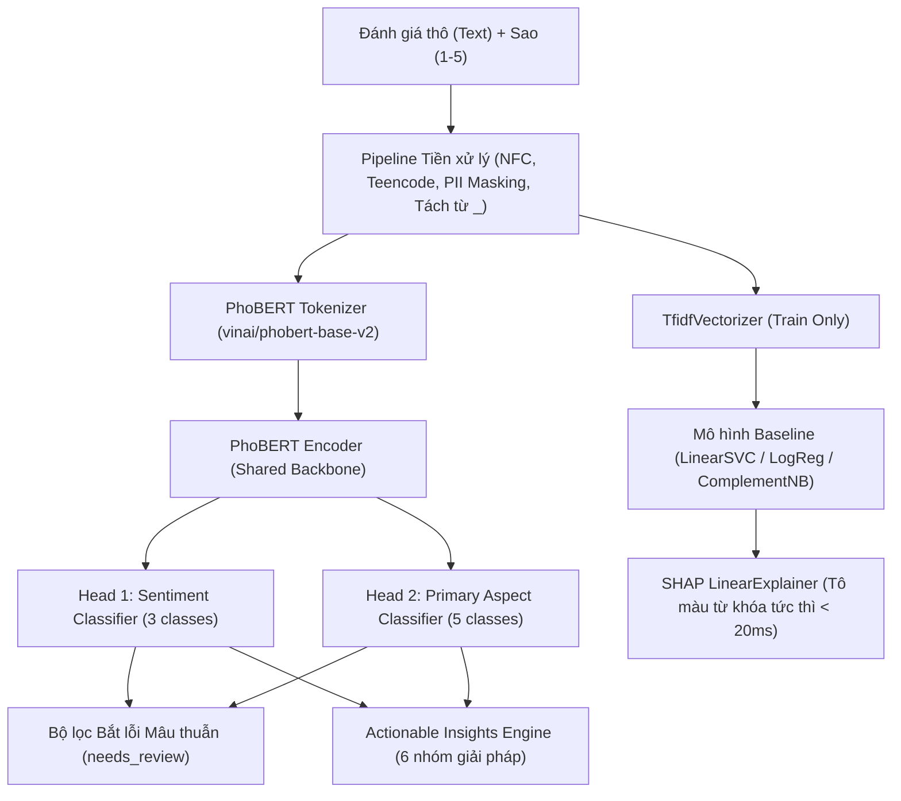

# TÀI LIỆU ĐẶC TẢ KỸ THUẬT (TECHNICAL SPECIFICATION) v1.0
## HỆ THỐNG PHÂN TÍCH ĐÁNH GIÁ KHÁCH HÀNG & ĐỀ XUẤT CẢI THIỆN SẢN PHẨM THƯƠNG MẠI ĐIỆN TỬ (VoC-INSIGHT)
**Ngữ cảnh đồ án:** Khóa luận Tốt nghiệp / Đồ án Chuyên ngành Khoa học Dữ liệu & Trí tuệ Nhân tạo  
**Thư mục dự án:** `d:\E-commerce\`  
**Bộ dữ liệu chuẩn:** **UIT-ViSFD** (Vietnamese Smartphone Feedback Dataset for Aspect-Based Sentiment Analysis — 11,122 đánh giá, IEEE 2021)  

---

### 1. TỔNG QUAN HỆ THỐNG & MỤC TIÊU NGHIỆP VỤ

#### 1.1. Bối cảnh & Nỗi đau của ngành Thương mại Điện tử (TMĐT)
Trên các sàn TMĐT lớn (Shopee, Tiki, Lazada, TikTok Shop), hàng triệu lượt đánh giá (reviews) được người mua để lại mỗi ngày. Tuy nhiên:
* **Hơn 85% doanh nghiệp / nhà bán hàng chỉ nhìn vào số sao trung bình** mà không thể đọc hết hàng ngàn bình luận dạng chữ.
* **Không phân tách được nguyên nhân:** Khách chấm 1 sao nhưng nhà bán hàng không biết do *Pin tụt nhanh*, *Màn hình bị xước*, hay do *Đơn vị vận chuyển làm móp méo hộp*.
* **Đánh giá mâu thuẫn (Rating Inconsistency):** Rất nhiều khách chấm 1 sao kèm lời khen nức nở (*"hàng rất đẹp, cho 1 sao cho shop bớt tự kiêu"*), hoặc chấm 5 sao để được hiện lên đầu nhưng bên dưới chửi lừa đảo.
* **File xuất thô "bẩn" (Dirty Ingestion):** Dữ liệu xuất từ Shopee Seller Center hay Tiki Partner thường bị lệch dòng tiêu đề, lẫn mã đơn hàng, định dạng CSV bị lỗi font tiếng Việt.

#### 1.2. Mục tiêu giải pháp của VoC-Insight
Xây dựng một hệ thống Trí tuệ Nhân tạo toàn diện hỗ trợ **Quản trị Trải nghiệm Khách hàng & Tiếng nói Người tiêu dùng (Voice of Customer - VoC)**:
1. **Phân tích Cảm xúc theo Khía cạnh (ABSA):** Ứng dụng mô hình **`PhoBERT Multi-Task`** để phân loại đồng thời **Cảm xúc** (Khen / Chê / Trung lập) và **Khía cạnh sản phẩm** (Hiệu năng, Màn hình/Camera, Pin/Sạc, Giá cả/Hậu mãi, Thiết kế/Chung).
2. **Minh bạch hóa AI (Explainable AI - XAI):** Dùng **SHAP** để bóc tách và tô màu trực tiếp các từ khóa cốt lõi khiến khách hàng bức xúc.
3. **Bộ lọc phát hiện mâu thuẫn (`needs_review`):** Tự động bắt các trường hợp lệch sao Likert hoặc độ tự tin thấp.
4. **Động cơ Đề xuất Hành động Thực tế (Actionable Insights Engine):** Gom cụm các phản hồi tiêu cực thành 6 nhóm giải pháp hành động cụ thể cho Nhà bán hàng / Hãng sản xuất.
5. **Bộ tự động nhận diện File xuất thô bẩn (Universal Ingestion):** Tự động đọc và chuẩn hóa 10 loại file Excel/CSV xuất thô từ sàn.
6. **Bảo mật PII:** Tự động che SĐT nhận hàng, Mã đơn hàng, Tên tài khoản để bảo vệ quyền riêng tư người mua.

---

### 2. BỘ DỮ LIỆU & QUY ĐỔI NHÃN (DATASET & ASPECT SCHEMA)

#### 2.1. Bộ dữ liệu UIT-ViSFD gốc
* **Quy mô:** 11,122 đánh giá người dùng thực tế cào từ các sàn TMĐT và chuỗi bán lẻ công nghệ lớn tại Việt Nam.
* **Phân chia chuẩn:**
  - `Train.csv`: **7,786 đánh giá** (70%)
  - `Dev.csv`: **1,112 đánh giá** (10%)
  - `Test.csv`: **2,224 đánh giá** (20%)
* **Các trường dữ liệu gốc:**
  - `comment`: Văn bản nhận xét thô bằng tiếng Việt.
  - `n_star`: Số sao đánh giá từ 1 đến 5 sao.
  - `date_time`: Mốc thời gian đánh giá.
  - `label`: Cặp nhãn `{ASPECT#Polarity}` (ví dụ: `{CAMERA#Positive};{BATTERY#Negative}`).

#### 2.2. Quy chuẩn 5 Khía cạnh Cốt lõi (Aspect Schema)
10 khía cạnh chi tiết của UIT-ViSFD được gom nhóm thành **5 nhóm khía cạnh thực tế TMĐT**:
| Mã ID | Mã Slug | Khía cạnh gốc UIT-ViSFD | Tên hiển thị Tiếng Việt | Nội dung trọng tâm |
| :---: | :--- | :--- | :--- | :--- |
| **`0`** | `PERF_FEAT` | `PERFORMANCE`, `STORAGE`, `FEATURES` | **Hiệu năng & Cấu hình** | Tốc độ xử lý, chơi game mượt/lag, dung lượng bộ nhớ, tính năng thông minh. |
| **`1`** | `SCREEN_CAM` | `SCREEN`, `CAMERA` | **Màn hình & Camera** | Độ nét hiển thị, cảm ứng, màu sắc, chụp đêm, góc rộng, quay video. |
| **`2`** | `BATTERY` | `BATTERY` | **Thời lượng Pin & Sạc** | Pin trâu, tụt pin nhanh, máy nóng khi sạc, củ sạc nhanh. |
| **`3`** | `PRICE_SER` | `PRICE`, `SER&ACC` | **Giá cả & Hậu mãi** | Đáng tiền, giá đắt, chính sách bảo hành, quà tặng kèm, phụ kiện, thái độ phục vụ. |
| **`4`** | `DESIGN_GEN` | `DESIGN`, `GENERAL`, `OTHERS` | **Thiết kế & Trải nghiệm chung** | Kiểu dáng, cầm đầm tay, viền mỏng, màu sắc sang trọng, nhận xét tổng quát. |

#### 2.3. Quy chuẩn 3 Sắc thái Cảm xúc (Sentiment Schema)
| Mã ID | Tên Slug | Tên hiển thị Tiếng Việt | Màu sắc UI |
| :---: | :--- | :--- | :--- |
| **`0`** | `negative` | **Tiêu cực (Chê / Góp ý lỗi)** | Đỏ (`#EF4444`) |
| **`1`** | `neutral` | **Trung lập (Nhận xét bình thường)** | Vàng cam (`#F59E0B`) |
| **`2`** | `positive` | **Tích cực (Khen ngợi / Hài lòng)** | Xanh lá (`#10B981`) |

---

### 3. KIẾN TRÚC MÔ HÌNH HỌC MÁY & DEEP LEARNING

#### 3.1. Mô hình Baseline TF-IDF (Notebook 03)
* `TfidfVectorizer(ngram_range=(1,2), max_features=12000, min_df=3, max_df=0.95, sublinear_tf=True)` fit **chỉ trên tập Train**.
* Huấn luyện và tinh chỉnh bằng `RandomizedSearchCV(cv=3, scoring='f1_macro', random_state=42)`:
  - `ComplementNB`: Tối ưu tham số smoothing `alpha`, `norm`.
  - `LogisticRegression`: Tối ưu tham số phạt `C`, `class_weight`.
  - `LinearSVC`: Mô hình Baseline mốc chuẩn tốt nhất.

#### 3.2. Mô hình Chính: PhoBERT Multi-Task (Notebook 04)
* **Backbone:** `vinai/phobert-base-v2`.
* **Cơ chế chống Overfit & Lệch nhãn:**
  - Smoothed Class Weights: $w_c = \sqrt{\frac{N}{K \cdot n_c}}$.
  - Label Smoothing Loss: `label_smoothing = 0.05`.
  - Linear Warmup Scheduler (10% tổng số bước huấn luyện) + AdamW (`lr=2e-5`, `weight_decay=0.02`).
  - Early Stopping theo dõi `dev_mean_f1` (trung bình F1 Cảm xúc + F1 Khía cạnh).

---

### 4. ĐỘNG CƠ ĐỀ XUẤT CẢI THIỆN SẢN PHẨM (ACTIONABLE INSIGHTS)

Gom cụm toàn bộ phản hồi tiêu cực thành **6 nhóm giải pháp thực chiến**:
1. **`Tối ưu Pin & Nguồn sạc`:** Phàn nàn về `hao pin`, `tụt pin`, `sạc chậm` $\rightarrow$ **Khuyến nghị:** Phát hành bản cập nhật firmware quản lý điện năng ngầm, tặng kèm củ sạc nhanh chính hãng.
2. **`Kiểm soát Chất lượng Màn hình & Camera`:** Phàn nàn về `màn hình ám vàng`, `chụp mờ`, `lóa sáng` $\rightarrow$ **Khuyến nghị:** Kiểm định lô linh kiện tấm nền màn hình tại nhà máy, bổ sung thuật toán AI chụp đêm.
3. **`Tinh chỉnh Hiệu năng & Nhiệt độ`:** Phàn nàn về `nóng máy`, `lag`, `văng app` $\rightarrow$ **Khuyến nghị:** Giảm xung nhịp chip khi nhiệt độ vượt ngưỡng, tối ưu hóa tương thích với các tựa game phổ biến.
4. **`Nâng cấp Quy chuẩn Đóng gói & Vận chuyển`:** Phàn nàn về `móp hộp`, `vỡ seal`, `giao chậm` $\rightarrow$ **Khuyến nghị:** Bọc thêm 2 lớp xốp bong bóng, dán tem Hàng dễ vỡ, đổi đối tác vận chuyển khu vực.
5. **`Chính sách Bảo hành & Đổi trả Hậu mãi`:** Phàn nàn về `bảo hành lâu`, `từ chối đổi mới` $\rightarrow$ **Khuyến nghị:** Áp dụng chính sách 1 đổi 1 trong 30 ngày cho lỗi nhà sản xuất, tặng voucher đền bù 100k.
6. **`Cập nhật Thông tin Mô tả Sản phẩm`:** Phàn nàn về `sai thông số`, `không giống ảnh` $\rightarrow$ **Khuyến nghị:** Cập nhật lại thông số camera/dung lượng thực tế và video mở hộp chân thực trên gian hàng.

---

### 5. QUY CHUẨN 10 FILE KHẢO SÁT TMĐT "BẨN" KIỂM THỬ (NOTEBOOK 06)

1. `01_shopee_clean.xlsx`: File xuất chuẩn từ Shopee Seller Center.
2. `02_tiki_semicolon_bom.csv`: File CSV xuất từ Tiki dùng dấu chấm phẩy `;` và mã hóa `UTF-8-SIG`.
3. `03_lazada_english.xlsx`: File Lazada với tên cột tiếng Anh (`review_content`, `star_rating`, `order_sn`).
4. `04_tiktok_title_offset.xlsx`: File TikTok Shop có 4 dòng tiêu đề báo cáo ở đầu (`header_row = 4`).
5. `05_pos_legacy.xls`: File định dạng Excel 97-2003 xuất từ phần mềm bán hàng KiotViet / Sapo.
6. `06_multi_sheet_report.xlsx`: File nhiều Sheet (`HuongDan`, `ThongKe`, `DanhGia`), dữ liệu nằm ở Sheet 3.
7. `07_utf16_tab_export.csv`: File CSV mã hóa `UTF-16` ngăn cách bằng Tab (`\t`).
8. `08_two_text_cols.xlsx`: File tách riêng 2 cột nhận xét (`Ưu điểm` và `Nhược điểm`).
9. `09_merged_cells_pagination.xlsx`: File có ô gộp (merged cells) và dòng tiêu đề bị lặp giữa trang.
10. `10_html_table_as_xls.xls`: Bảng HTML xuất thô được đổi đuôi thành `.xls`.

---

### 6. QUY TẮC PHÁT TRIỂN & CODING STYLE
* Tuyệt đối tuân thủ `d:\What-If Simulator\coding_style.md`:
  - Mỗi notebook chia cell ngắn 1–5 dòng.
  - Có cell kiểm tra `.info()`, `.head()`, `.value_counts()` ngay sau biến đổi.
  - Thử trên biến `tempt` trước khi gọi `.apply()`.
  - Comment `#` không dấu cách giải thích lý do, tiêu đề Markdown HOA ngắn gọn, `random_state=42`.
