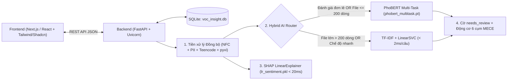

# TÀI LIỆU BÀN GIAO XÂY DỰNG ỨNG DỤNG WEB — VoC-INSIGHT (PHIÊN BẢN v2.0)

**Tên hệ thống:** Hệ thống Phân tích Tiếng nói Khách hàng & Đề xuất Cải thiện Sản phẩm TMĐT (**VoC-Insight**)  
**Bộ dữ liệu chuẩn:** UIT-ViSFD (Vietnamese Smartphone Feedback Dataset — 11,122 đánh giá: `7,786` Train / `350` Eyeball Dev / `762` Blackbox Dev / `2,224` Test)  
**Kiến trúc ứng dụng mục tiêu:** **FastAPI (Python Backend)** + **SQLite (`voc_insight.db`)** + **React / Next.js (Frontend)**  
**Phiên bản:** `2.0` — Đồng bộ 100% với bộ Notebook v2.0 (đã sửa nhãn đa khía cạnh, tách từ `pyvi`, chia Eyeball/Blackbox Dev, bao phủ MECE 100% Actionable Insights và xử lý Excel bẩn toàn diện).

---

## 1. TỔNG QUAN KIẾN TRÚC & CHIẾN LƯỢC HYBRID AI TRÊN PRODUCTION



### 1.1. Chiến lược Hybrid AI (Phân vai thông minh)
1. **Phân tích 1 đánh giá tức thì (`POST /api/v1/predict`):**
   - Dùng **PhoBERT Multi-Task (`phobert_multitask.pt`)** để đạt độ chính xác tối đa (`Sentiment Macro F1 = 0.7925`, `Multi-Label Aspect Macro F1 = 0.9082`, có hiệu chuẩn nhiệt độ `calibration.json`). Thời gian suy luận trên CPU ~50–120ms/câu.
   - Song song dùng **`lr_sentiment.pkl` + `tfidf_vectorizer.pkl` + `shap.LinearExplainer`** để trích xuất trọng số từ khóa giải thích thời gian thực (<20ms).
2. **Phân tích hàng loạt File Excel/CSV (`POST /api/v1/upload/analyze`):**
   - **Nếu tổng số dòng $\le 200$** (và `model_mode` là `auto` hoặc `phobert`): Chạy **PhoBERT Multi-Task** theo batch (`batch_size=32`, mất ~3–10 giây trên CPU) để cho kết quả chính xác nhất.
   - **Nếu tổng số dòng $> 200$** (hoặc `model_mode == "baseline"`): Tự động chuyển sang **Baseline TF-IDF** (`baseline_sentiment.pkl` LR + `baseline_aspect_multilabel.pkl` OVR LinearSVC + 5 ngưỡng OOF trong `baseline_aspect_thresholds.json`), kèm cờ **`Khieu_Nai_Ngam_4_5_Sao` (`SILENT_COMPLAINT`)** khi `n_star >= 4` & `P(neg) >= 0.50`, để xử lý hàng nghìn dòng trong < 1 giây mà không làm treo server.

### 1.2. Chỉ số Benchmark Chính thức (Tập Test Độc lập — 2,224 đánh giá)
Trích xuất nguyên bản từ [model_metadata.json](file:///d:/E-commerce/models/model_metadata.json):

| Bài toán (Task) | Chỉ số (Metric) | Baseline (`TF-IDF LR + OVR SVC`) | **PhoBERT Multi-Task (Chốt)** | Mức cải thiện ($\Delta$) |
| :--- | :--- | :---: | :---: | :---: |
| **Cảm xúc (3 lớp)** | **Macro F1** | `0.7345` | **`0.7925` (79.25%)** | **+5.80%** |
| | **Accuracy** | `0.7824` | **`0.8377` (83.77%)** | **+5.53%** |
| **Đa khía cạnh (Multi-label 5 nhóm)** | **Macro F1** | `0.9058` | **`0.9082` (90.82%)** | **+0.24%** |
| **Khía cạnh chính (Primary)** | **Hit-Any-True-Group** | `0.9586` | **`0.9496`** *(Overlap ML: `0.9838`)* | — |

---

## 2. DANH MỤC TÀI NGUYÊN BÀN GIAO & CÀI ĐẶT MÔI TRƯỜNG

### 2.1. Các file cần nạp vào Backend
* **Thư mục `models/`:**
  * `phobert_multitask/phobert_multitask.pt` (~540 MB — **Lưu ý Git:** file này nằm trong `.gitignore` vì vượt 100MB; khi clone repo từ GitHub về, tải file `.pt` từ Google Drive bỏ vào đúng thư mục `models/phobert_multitask/`).
  * `phobert_multitask/config.json`, `vocab.txt`, `bpe.codes`, `tokenizer_config.json`, `added_tokens.json`, `calibration.json` (đã có sẵn, giúp nạp PhoBERT & ngưỡng hiệu chuẩn **hoàn toàn offline** không cần tải lại từ HuggingFace!).
  * `tfidf_vectorizer.pkl`, `baseline_sentiment.pkl`, `baseline_aspect_multilabel.pkl`, `baseline_aspect_thresholds.json`, `svc_sentiment.pkl`, `svc_aspect.pkl`, `lr_sentiment.pkl`, `lr_aspect.pkl`.
  * `model_metadata.json`, `phobert_multitask/training_history.json` (`6` epochs).
* **Thư mục `data/processed/`:**
  * `train_clean.csv` (`7,776` dòng sau lọc trùng — dùng làm **background matrix** cho `shap.LinearExplainer` khi khởi động server, hoặc sample 100 mẫu tiêu biểu để tăng tốc).
  * `test_pred_phobert.csv` (`2,224` dòng, `26` cột đa nhãn — dùng để **seed dữ liệu ban đầu** vào SQLite `voc_insight.db`).
  * `actionable_insights.csv` (`6` cụm giải pháp chuẩn MECE trên `779` câu tiêu cực của tập Test).
* **Thư mục `data/samples_messy/`:** Đủ 10 file xuất thô sàn TMĐT bẩn để gắn nút test nhanh trên UI Tab 2.

### 2.2. Thư viện Python bắt buộc cho Backend (`requirements.txt` bổ sung)
Ngoài các thư viện có sẵn trong [requirements.txt](file:///d:/E-commerce/requirements.txt), Backend cần cài thêm:
```bash
pip install fastapi uvicorn python-multipart pyvi chardet sqlalchemy pydantic openpyxl xlrd lxml
```

---

## 3. BẢNG QUY ĐỔI NHÃN CHUẨN & ĐẶC TẢ CÁC HÀM LÕI (BẮT BUỘC DÙNG CHUNG)

> [!CAUTION]
> **Chống Training-Serving Skew:** Backend tuyệt đối không được tự chế quy tắc làm sạch khác với [01_text_cleaning_and_pii.ipynb](file:///d:/E-commerce/notebooks/01_text_cleaning_and_pii.ipynb). Mọi văn bản nhập tay hay đọc từ Excel đều **bắt buộc** đi qua đúng hàm `clean_text()` $\rightarrow$ `segment_words()` dưới đây trước khi đưa vào `tfidf.transform()` hoặc `PhoBERT Tokenizer`.

### 3.1. Bảng ánh xạ Nhãn (Label Mapping)

**Cảm xúc (`sentiment` / `pred_sentiment`):**
| ID | Mã Enum | Tiếng Việt hiển thị | Màu UI (Hex) |
| :---: | :--- | :--- | :---: |
| `0` | `NEGATIVE` | **Tiêu cực** | `#EF4444` (Đỏ) |
| `1` | `NEUTRAL` | **Trung lập / Hỗn hợp** | `#F59E0B` (Vàng cam) |
| `2` | `POSITIVE` | **Tích cực** | `#10B981` (Xanh lá) |

**Khía cạnh (`aspect_group` / `pred_aspect`):**
| ID | Mã Enum | Tiếng Việt hiển thị | Nhóm UIT-ViSFD gốc |
| :---: | :--- | :--- | :--- |
| `0` | `PERF_FEAT` | **Hiệu năng & Cấu hình** | `PERFORMANCE`, `STORAGE`, `FEATURES` |
| `1` | `SCREEN_CAM` | **Màn hình & Camera** | `SCREEN`, `CAMERA` |
| `2` | `BATTERY` | **Thời lượng Pin & Sạc** | `BATTERY` |
| `3` | `PRICE_SER` | **Giá cả & Hậu mãi** | `PRICE`, `SER&ACC` |
| `4` | `DESIGN_GEN` | **Thiết kế & Tổng quan** | `DESIGN`, `GENERAL`, `OTHERS` |

---

### 3.2. Module 1: Tiền xử lý Văn bản, Ẩn danh PII & Tách từ `pyvi` (`app/core/preprocessor.py`)

Copy chính xác khối logic từ [01_text_cleaning_and_pii.ipynb](file:///d:/E-commerce/notebooks/01_text_cleaning_and_pii.ipynb) và [06_excel_auto_detector.ipynb](file:///d:/E-commerce/notebooks/06_excel_auto_detector.ipynb):

```python
import re
import unicodedata
from pyvi import ViTokenizer

TEENCODE_DICT = {
    'ko': 'không', 'k': 'không', 'kh': 'không', 'hong': 'không', 'hok': 'không', 'hk': 'không', 'kg': 'không',
    'đc': 'được', 'dc': 'được', 'đk': 'được', 'dk': 'được', 'sp': 'sản phẩm', 'đt': 'điện thoại', 'dt': 'điện thoại',
    'nv': 'nhân viên', 'nvtv': 'nhân viên tư vấn', 'bh': 'bảo hành', 'ttbh': 'trung tâm bảo hành',
    'tgdd': 'thế giới di động', 'tgdđ': 'thế giới di động', 'tgd': 'thế giới di động',
    'đmx': 'điện máy xanh', 'dmx': 'điện máy xanh', 'mk': 'mình', 'mik': 'mình', 'm': 'mình',
    'mn': 'mọi người', 'mng': 'mọi người', 'bth': 'bình thường', 'bt': 'bình thường',
    'sd': 'sử dụng', 'trc': 'trước', 'vs': 'với', 'j': 'gì', 'z': 'vậy', 'v': 'vậy', 'cx': 'cũng', 'r': 'rồi',
    'okie': 'ok', 'oke': 'ok', 'oki': 'ok', 'tl': 'trả lời', 'ib': 'nhắn tin', 'shop': 'cửa hàng',
    'ship': 'giao hàng', 'đh': 'đơn hàng', 'auth': 'chính hãng', 'fake': 'hàng giả', 'fpt': 'fpt shop', 'cam': 'camera'
}

SPAM_PATTERNS = {'nhận xu', 'chưa dùng', 'cho 5 sao nhận xu', 'đã nhận hàng', 'không có ý kiến', 'chưa thử'}

def normalize_and_mask(t: str) -> str:
    t = unicodedata.normalize('NFC', str(t)).lower()
    t = re.sub(r'https?://\S+|www\.\S+', ' _u_r_l_ ', t)
    t = re.sub(r'[\w\.-]+@[\w\.-]+\.\w+', ' _e_m_a_i_l_ ', t)
    t = re.sub(r'#?(?:dh|đh|ord|spx)[0-9a-z]{4,}\b', ' _o_r_d_ ', t)
    t = re.sub(r'(?:0|\+84)[\s\.]?[0-9]{2,3}[\s\.]?[0-9]{3}[\s\.]?[0-9]{3,4}\b', ' _p_h_o_n_e_ ', t)
    return re.sub(r'([a-zÀ-ỹ])\1{2,}', r'\1', t)

def clean_text(t: str) -> str:
    if not isinstance(t, str):
        return ''
    t = normalize_and_mask(t)
    vowel_pats = [
        r'([àáảãạăằắẳẵặâầấẩẫậ])[aăâ]+', r'([èéẻẽẹêềếểễệ])[eê]+',
        r'([òóỏõọôồốổỗộơờớởỡợ])[oôơ]+', r'([ùúủũụưừứửữự])[uư]+',
        r'([ìíỉĩị])i+', r'([ỳýỷỹỵ])y+', r'([a-zÀ-ỹ])\1+(?=\W|$)'
    ]
    for pat in vowel_pats:
        t = re.sub(pat, r'\1', t)
    t = re.sub(r'\b\w+\b', lambda m: TEENCODE_DICT.get(m.group(0), m.group(0)), t)
    for k, v in [('_u_r_l_', '[URL]'), ('_e_m_a_i_l_', '[EMAIL]'), ('_o_r_d_', '[ORDER_ID]'), ('_p_h_o_n_e_', '[PHONE]')]:
        t = t.replace(k, v)
    return re.sub(r'\s+', ' ', t).strip()

def check_no_content(cleaned_text: str) -> bool:
    c = cleaned_text.strip().lower()
    return (not c) or (c in SPAM_PATTERNS)

def segment_words(cleaned_text: str) -> str:
    if not isinstance(cleaned_text, str) or not cleaned_text.strip():
        return ''
    tok = ViTokenizer.tokenize(cleaned_text).replace('trải nghiệm', 'trải_nghiệm')
    for pii in ['URL', 'EMAIL', 'ORDER_ID', 'PHONE']:
        tok = re.sub(r'\[\s*' + pii + r'\s*\]', f'[{pii}]', tok)
    return tok
```

---

### 3.3. Module 2: Nạp Model Offline PhoBERT + TF-IDF + SHAP (`app/core/ai_engine.py`)

> [!TIP]
> **Mẹo nạp PhoBERT không cần Internet:** Vì thư mục `models/phobert_multitask/` đã có sẵn `config.json`, hãy dùng `AutoConfig.from_pretrained` + `AutoModel.from_config(cfg)` trước khi `load_state_dict()`, tránh gọi `AutoModel.from_pretrained('vinai/phobert-base-v2')` khiến server tự tải lại 540MB mỗi lần deploy mới.

```python
import os, json, joblib, torch
import torch.nn as nn
import numpy as np
import pandas as pd
import shap
from transformers import AutoConfig, AutoModel, AutoTokenizer

class PhoBertMultiTask(nn.Module):
    def __init__(self, model_dir: str, dropout: float = 0.3):
        super().__init__()
        cfg = AutoConfig.from_pretrained(model_dir)
        self.encoder = AutoModel.from_config(cfg)
        hidden = cfg.hidden_size
        self.drop = nn.Dropout(dropout)
        self.sent_head = nn.Linear(hidden, 3)
        self.asp_head = nn.Linear(hidden, 5)

    def forward(self, input_ids, attention_mask):
        out = self.encoder(input_ids=input_ids, attention_mask=attention_mask)
        cls_vec = self.drop(out.last_hidden_state[:, 0, :])
        return self.sent_head(cls_vec), self.asp_head(cls_vec)
```

**Quy tắc trích xuất SHAP Local không bị đảo dấu (`app/core/ai_engine.py`):**
- Nạp background `X_bg = tfidf.transform(df_train['sentence_seg'].fillna(''))` 1 lần lúc startup (`Global Singleton`).
- Khởi tạo `explainer = shap.LinearExplainer(lr_sentiment, X_bg)`.
- Khi giải thích 1 câu `vec_one = tfidf.transform([sentence_seg])`:
  - `sv_one = explainer.shap_values(vec_one)`
  - Lấy vector SHAP ứng với **Lớp `0` (Tiêu cực)**: `sv_neg = sv_one[0, :, 0] if getattr(sv_one, 'ndim', 0) == 3 else sv_one[0][0]`
  - Lấy vector SHAP ứng với **Lớp `2` (Tích cực)**: `sv_pos = sv_one[0, :, 2] if getattr(sv_one, 'ndim', 0) == 3 else sv_one[2][0]`
  - **Quy tắc hiển thị màu:**
    - Nếu `sv_neg[i] > 0.02`: Token đẩy mạnh về **Tiêu cực** $\rightarrow$ `impact = "negative"`, `color = "red"`.
    - Nếu `sv_pos[i] > 0.02`: Token đẩy mạnh về **Tích cực** $\rightarrow$ `impact = "positive"`, `color = "green"`.
    - *(Tuyệt đối không dùng `-abs(x)` khi lọc top từ khóa gây Tiêu cực! Chỉ lọc `sv_neg[i] > 0` và sắp xếp giảm dần theo `-sv_neg[i]`.)*

**Quy tắc gắn cờ kiểm duyệt `needs_review`:**
```python
star_contra = ((star_rating <= 2) and (pred_sentiment == 2)) or ((star_rating >= 4) and (pred_sentiment == 0))
low_conf = (sentiment_conf < 0.65) or (aspect_conf < 0.65)
needs_review = bool(low_conf or star_contra or is_no_content)
```

---

### 3.4. Module 3: Động cơ Đọc File Excel/CSV Bẩn Vạn năng (`app/core/excel_ingestion.py`)

Xử lý đạt **10/10 file mẫu (`100% PASS`)**, bao gồm HTML đội lốt `.xls`, UTF-16 Tab, file lệch dòng tiêu đề, gộp 2 cột nhận xét (`08_two_text_cols.xlsx`), và lọc dòng tiêu đề lặp + điền khuyết merged cells (`09_merged_cells_pagination.xlsx`):

```python
import os, re, chardet
import pandas as pd

KW_GOOD = ['đánh giá', 'nhận xét', 'review', 'comment', 'nội dung', 'phản hồi', 'ý kiến', 'ưu điểm', 'nhược điểm']
KW_BAD = ['mã', 'id', 'sđt', 'phone', 'sao', 'rating', 'tên', 'name', 'ngày', 'date', 'thời gian', 'time', 'review_text', 'combined_review']

def read_any_file(file_path: str) -> dict[str, pd.DataFrame]:
    ext = os.path.splitext(file_path)[1].lower()
    if ext == '.xlsx':
        return pd.read_excel(file_path, sheet_name=None, engine='openpyxl')
    if ext == '.xls':
        with open(file_path, 'rb') as f:
            head = f.read(200).lower()
        if b'<html' in head or b'<!doctype' in head or b'<table' in head:
            return {'Sheet1': pd.read_html(file_path)[0]}
        return pd.read_excel(file_path, sheet_name=None, engine='xlrd')
    with open(file_path, 'rb') as f:
        raw = f.read(10000)
    enc = chardet.detect(raw)['encoding'] or 'utf-8'
    txt = raw.decode(enc, errors='ignore')
    sep = '\t' if ('utf-16' in enc.lower() and b'\t' in raw) else (';' if txt.count(';') > txt.count(',') else ',')
    return {'Sheet1': pd.read_csv(file_path, sep=sep, encoding=enc)}

def pick_best_sheet(sheets_dict: dict[str, pd.DataFrame]):
    best_name, best_score = None, -1
    for name, df_s in sheets_dict.items():
        score = sum((df_s[col].astype(str).str.len() > 15).sum() for col in df_s.columns)
        if score > best_score:
            best_name, best_score = name, score
    return best_name, sheets_dict[best_name]

def detect_header_row(raw_df: pd.DataFrame, max_scan: int = 15) -> int:
    kw = ['đánh giá', 'nhận xét', 'review', 'comment', 'nội dung', 'sao', 'rating', 'khách', 'buyer', 'phản hồi', 'ý kiến', 'stt', 'mã', 'ưu điểm', 'nhược điểm']
    best_idx, best_cnt = 0, -1
    for i in range(min(max_scan, len(raw_df))):
        row_vals = [str(x).lower().strip() for x in raw_df.iloc[i].dropna().tolist()]
        cnt = sum(1 for v in row_vals if any(k in v for k in kw))
        if cnt > best_cnt:
            best_idx, best_cnt = i, cnt
    return best_idx if best_cnt >= 2 else 0

def detect_text_columns(df: pd.DataFrame) -> list[str]:
    text_cols = []
    for col in df.columns:
        c_low, col_str = str(col).lower().strip(), df[col].dropna().astype(str)
        if not any(b in c_low for b in KW_BAD) and len(col_str) > 0:
            if (any(g in c_low for g in KW_GOOD) and col_str.str.len().mean() > 10) or col_str.str.len().mean() > 25:
                text_cols.append(col)
    return text_cols

def detect_star_column(df: pd.DataFrame):
    for col in df.columns:
        if any(k in str(col).lower().strip() for k in ['sao', 'star', 'rating', 'điểm', 'score']):
            return col
    for col in df.columns:
        s = pd.to_numeric(df[col], errors='coerce').dropna()
        if len(s) > 5 and s.between(1, 5).mean() > 0.8:
            return col
    return None

def build_clean_table(raw_df: pd.DataFrame, header_row: int | None = None) -> pd.DataFrame:
    if header_row is None:
        header_row = detect_header_row(raw_df)
    if header_row == 0 and not isinstance(raw_df.columns[0], int):
        df_c = raw_df.dropna(how='all').copy()
    else:
        df_c = raw_df.iloc[header_row + 1:].dropna(how='all').copy()
        df_c.columns = [str(h).strip() if pd.notna(h) and str(h).strip() != '' else f'Col_{j}' for j, h in enumerate(raw_df.iloc[header_row])]
    col_low = [str(c).lower().strip() for c in df_c.columns]
    # Lọc bỏ dòng tiêu đề lặp lại ở giữa trang báo cáo (file 09)
    df_clean = df_c[~df_c.apply(lambda r: sum(str(v).lower().strip() == c for v, c in zip(r, col_low)) >= 2, axis=1)].reset_index(drop=True)
    txt_cols = detect_text_columns(df_clean)
    meta_cols = [c for c in df_clean.columns if c not in txt_cols]
    df_clean[meta_cols] = df_clean[meta_cols].ffill()
    if len(txt_cols) >= 2:
        df_clean['review_text'] = df_clean[txt_cols].apply(lambda r: '. '.join(str(x).strip() for x in r if pd.notna(x) and str(x).strip() != ''), axis=1)
    elif len(txt_cols) == 1:
        df_clean['review_text'] = df_clean[txt_cols[0]].astype(str)
    else:
        df_clean['review_text'] = ''
    # Ẩn danh các cột nhạy cảm (SĐT, Mã đơn hàng) nếu tồn tại trong file xuất
    for c in df_clean.columns:
        cl = str(c).lower()
        if 'điện thoại' in cl or 'sđt' in cl or 'phone' in cl:
            df_clean[c] = df_clean[c].astype(str).apply(lambda s: re.sub(r'[0-9]{6,}', '[PHONE]', s))
    return df_clean
```

---

### 3.5. Module 4: Động cơ 6 Nhóm Đề Xuất Hành Động Chuẩn MECE (`app/core/insights_engine.py`)

Thay thế hoàn toàn bảng từ khóa rời rạc ở bản v1.0. Áp dụng phân hoạch **MECE (Độc quyền & Trọn vẹn)** để đảm bảo **100% đánh giá tiêu cực (`pred_sentiment == 0`)** được phân bổ hết vào 6 nhóm giải pháp (0% rơi rụng, 0% gán nhầm trầy vỏ sang vận chuyển):

```python
CAM_PATTERN = r'(?<!\w)(?:chụp|cam|camera|ảnh|quay|mờ|nét|zoom|selfie)(?!\w)'

MECE_GROUPS = [
    (0, 'all', 'Hiệu năng & Cấu hình', 'lag, giật, đơ, sóng yếu, phần mềm',
     'Tối ưu Hiệu năng, Đa nhiệm & Xử lý Giật Lag: Phát hành bản vá tối ưu quản lý RAM/CPU, kiểm soát xung nhịp và rà soát lỗi kết nối wifi/sóng.'),
    (2, 'all', 'Thời lượng Pin & Sạc', 'tụt pin, hao pin, nóng máy, sạc chậm',
     'Cải thiện Thời lượng Pin, Kiểm soát Nhiệt độ & Củ sạc: Rà soát mạch quản lý nguồn, kiểm định bộ sạc kèm máy và tối ưu ứng dụng chạy ngầm.'),
    (1, 'cam', 'Màn hình & Camera - Nhóm Camera', 'chụp mờ, camera, ảnh, quay, zoom',
     'Nâng cấp Thuật toán Xử lý Ảnh & Chất lượng Cụm Camera: Tinh chỉnh thuật toán lấy nét/chụp thiếu sáng và kiểm tra chất lượng thấu kính xuất xưởng.'),
    (1, 'scr', 'Màn hình & Camera - Nhóm Màn hình', 'màn hình, cảm ứng, hiển thị, ám, sọc',
     'Kiểm soát Chất lượng Tấm nền Hiển thị & Độ nhạy Cảm ứng: Siết chặt QC độ nhạy cảm ứng, tấm nền màn hình và hỗ trợ đổi mới nếu lỗi hiển thị.'),
    (3, 'all', 'Giá cả & Hậu mãi', 'bảo hành, nhân viên, giá, tư vấn, đổi trả',
     'Chuẩn hóa Quy trình Bảo hành, CSKH & Chính sách Giá/Hậu mãi: Đào tạo lại thái độ nhân viên, rút ngắn thời gian bảo hành đổi trả và minh bạch ưu đãi.'),
    (4, 'all', 'Thiết kế & Tổng quan', 'thiết kế, vỏ, ngoại quan, phụ kiện, đóng gói',
     'Nâng cấp Độ bền Vật liệu Ngoại quan, Phụ kiện & Quy chuẩn Đóng gói: Kiểm tra ngoại quan khung viền/mặt lưng và phụ kiện đi kèm trước khi bàn giao.')
]
```

*(Trên tập Test 2,224 đánh giá hiện tại: `779` câu tiêu cực phân bổ vào 6 nhóm đúng bằng `334 + 214 + 113 + 89 + 16 + 13 = 779`).*

---

## 4. THIẾT KẾ CƠ SỞ DỮ LIỆU SQLITE (`voc_insight.db`)

Khi Backend FastAPI khởi động lần đầu (`lifespan` event), kiểm tra nếu file `voc_insight.db` chưa có dữ liệu thì tự động **seed `2,224` dòng từ `data/processed/test_pred_phobert.csv`** vào bảng `reviews`.

```sql
CREATE TABLE IF NOT EXISTS upload_batches (
    id INTEGER PRIMARY KEY AUTOINCREMENT,
    file_name TEXT NOT NULL,
    detected_format TEXT,
    sheet_name TEXT,
    total_rows INTEGER NOT NULL,
    model_used TEXT NOT NULL,           -- 'phobert' hoặc 'baseline'
    created_at TIMESTAMP DEFAULT CURRENT_TIMESTAMP
);

CREATE TABLE IF NOT EXISTS reviews (
    id INTEGER PRIMARY KEY AUTOINCREMENT,
    source TEXT NOT NULL,               -- 'seed_test' | 'buyer_portal' | 'excel_upload'
    batch_id INTEGER REFERENCES upload_batches(id),
    n_star INTEGER NOT NULL,            -- 1..5
    raw_text TEXT,                      -- Chỉ dùng nội bộ hoặc ẩn PII trước khi lưu
    sentence_clean TEXT NOT NULL,       -- Văn bản đã che PII [PHONE], [ORDER_ID], [EMAIL]
    sentence_seg TEXT NOT NULL,         -- Văn bản đã tách từ pyvi
    is_no_content BOOLEAN DEFAULT 0,
    pred_sentiment INTEGER NOT NULL,    -- 0, 1, 2
    pred_aspect INTEGER NOT NULL,       -- 0, 1, 2, 3, 4
    sentiment_conf REAL NOT NULL,
    aspect_conf REAL NOT NULL,
    needs_review BOOLEAN DEFAULT 0,
    review_status TEXT DEFAULT 'pending', -- 'pending' | 'resolved' | 'ignored'
    created_at TIMESTAMP DEFAULT CURRENT_TIMESTAMP
);
```

> [!IMPORTANT]
> **Nguyên tắc Privacy by Design:** Khi người mua gửi đánh giá từ Buyer Portal hoặc upload Excel, **bắt buộc chạy `clean_text()` để che toàn bộ `[PHONE]`, `[EMAIL]`, `[ORDER_ID]` trước khi `INSERT` vào `reviews`**.

---

## 5. ĐẶC TẢ REST API CONTRACT (FASTAPI `/api/v1`)

Backend cần bật CORS cho Frontend (`http://localhost:3000`).

### 5.1. `POST /api/v1/predict` — Phân tích tức thì 1 câu & Lưu đồng bộ sang Dashboard
* **Request JSON:**
  ```json
  {
    "text": "Đặt đơn #ĐH889911 giao nhanh nhưng pin tụt quá, gọi 0901234567 không ai nghe",
    "star_rating": 5,
    "save_to_db": true
  }
  ```
* **Pipeline xử lý:** `clean_text` $\rightarrow$ `check_no_content` $\rightarrow$ `segment_words` $\rightarrow$ `PhoBERT Multi-Task` (nếu `is_no_content=False`) $\rightarrow$ `SHAP LinearExplainer` $\rightarrow$ `needs_review` $\rightarrow$ `INSERT` vào SQLite (`source='buyer_portal'`).
* **Response JSON (`200 OK`):**
  ```json
  {
    "success": true,
    "data": {
      "review_id": 2225,
      "anonymized_text": "đặt đơn [ORDER_ID] giao nhanh nhưng pin tụt quá, gọi [PHONE] không ai nghe",
      "sentence_seg": "đặt đơn [ORDER_ID] giao nhanh nhưng pin tụt quá , gọi [PHONE] không ai nghe",
      "is_no_content": false,
      "model_used": "phobert_multitask",
      "sentiment": { "id": 0, "label": "NEGATIVE", "display_name": "Tiêu cực", "confidence": 0.9124 },
      "aspect": { "id": 2, "label": "BATTERY", "display_name": "Thời lượng Pin & Sạc", "confidence": 0.8740 },
      "star_rating": 5,
      "needs_review": true,
      "review_reason": "star_contradiction",
      "shap_explanation": {
        "inference_time_ms": 14.2,
        "tokens": [
          { "token": "tụt", "shap_value": 0.421, "impact": "negative", "color": "red" },
          { "token": "không", "shap_value": 0.215, "impact": "negative", "color": "red" },
          { "token": "nhanh", "shap_value": -0.198, "impact": "positive", "color": "green" }
        ]
      }
    }
  }
  ```

### 5.2. `POST /api/v1/upload/inspect` — Dò cấu trúc File Excel/CSV bẩn (Tab 2)
* **Request:** `multipart/form-data` chứa `file` (hoặc query `sample_name=09_merged_cells_pagination.xlsx` để bấm nút demo nhanh 10 file có sẵn trong `data/samples_messy/`).
* **Response JSON (`200 OK`):** Trả về `temp_file_id`, `detected_format`, `sheets_found`, `selected_sheet`, `detected_header_row_index`, `detected_text_columns`, `detected_star_column`, `total_rows_estimated`, và `preview_rows` (5 dòng đầu đã làm sạch lặp tiêu đề & ffill merged cells).

### 5.3. `POST /api/v1/upload/analyze` — Chạy phân tích hàng loạt & Xuất Excel kết quả
* **Request JSON:**
  ```json
  {
    "temp_file_id": "uuid-...",
    "sheet_name": "DanhSach",
    "header_row_index": 1,
    "model_mode": "auto",     // "auto" (<=200 dùng PhoBERT, >200 dùng Baseline) | "phobert" | "baseline"
    "save_to_db": true
  }
  ```
* **Response JSON (`200 OK`):** Trả về `batch_id`, `model_used`, `total_processed`, `inference_time_ms`, `sentiment_summary` (`positive`, `negative`, `neutral`), `needs_review_count`, `actionable_insights` (tính theo MECE ngay trên file vừa upload), và `download_result_url` (`/api/v1/upload/download/{batch_id}`).

### 5.4. `GET /api/v1/dashboard/overview` — Dữ liệu tổng hợp Real-time từ SQLite (Tab 1 & Tab 4)
* **Query Params:** `?source=all|seed_test|buyer_portal|excel_upload` (hoặc `batch_id`).
* **Response JSON:**
  * `system_metrics`: `total_reviews` (`2224` mặc định ban đầu), `positive_count` (`1032`), `negative_count` (`779`), `neutral_count` (`413`), `needs_review_count` (`562`).
  * `aspect_breakdown`: Thống kê Khen / Trung lập / Chê cho từng nhóm trong 5 khía cạnh.
  * `actionable_insights`: Tính động bằng `MECE_GROUPS` trên toàn bộ câu tiêu cực hiện hành trong DB (100% bao phủ).
  * `model_metadata`: Đọc từ `models/model_metadata.json` + `training_history.json` (hiển thị biểu đồ Loss & Blackbox Dev F1 qua `6` epochs trên Tab 4).

### 5.5. `GET /api/v1/reviews` & `PATCH /api/v1/reviews/{id}` — Tra cứu, SHAP & Duyệt cờ (Tab 3)
* **`GET /api/v1/reviews`:** Hỗ trợ phân trang (`page`, `limit`), lọc (`sentiment`, `aspect`, `needs_review`, `review_status`, `source`, `q`).
* **`GET /api/v1/reviews/{id}/shap`:** Tính nhanh SHAP từ khóa (<20ms) cho dòng đánh giá bất kỳ khi người dùng bấm *"Xem giải thích AI"*.
* **`PATCH /api/v1/reviews/{id}`:** Cho phép CSKH sửa tay `pred_sentiment`, `pred_aspect`, và chuyển `review_status = "resolved"` (hoặc tắt `needs_review = false`). Khi cập nhật, Dashboard Tab 1 tự tính lại số liệu ngay lập tức.

---

## 6. ĐẶC TẢ GIAO DIỆN FRONTEND (NEXT.JS / REACT)

Cấu trúc 2 vai trò chuyển đổi ở Top Navigation Bar:
1. **`🛍️ Cổng Người Mua Hàng (Buyer Portal)`:**
   - Thông tin sản phẩm mẫu + chọn 1–5 sao tương tác + Textarea nhập nhận xét.
   - 3 nút **Demo 1-Click**: (1) Khen mượt/pin trâu, (2) Chê nóng máy/tụt pin + chứa SĐT/Mã đơn để demo tự động che `[PHONE]`/`[ORDER_ID]`, (3) Bẫy mâu thuẫn 1 sao nhưng viết khen nức nở.
   - Hiển thị ngay thẻ kết quả PhoBERT + các từ khóa tô màu Đỏ/Xanh từ SHAP + cảnh báo mâu thuẫn sao (nếu có) + badge *"Đã đồng bộ sang Dashboard Nhà bán hàng"*.
2. **`📊 Bảng Điều Khiển Nhà Bán Hàng (Seller Analytics Dashboard)` — 4 Tab:**
   - **Tab 1 (Tổng quan & Actionable Insights):** 4 Metric Cards (`2,224` đánh giá, `46.4%` Tích cực, `35.0%` Tiêu cực, `562` Cần duyệt); Biểu đồ Donut Cảm xúc + Stacked Bar 5 Khía cạnh; Bảng **6 Giải pháp Hành động MECE** (hiển thị đủ `779/779` câu tiêu cực, không sót câu nào).
   - **Tab 2 (Upload File Báo Cáo Sàn TMĐT Bẩn):** Drag-and-drop `.xlsx/.xls/.csv` + Thanh **10 nút Test File Mẫu** (`data/samples_messy/`); Card hiển thị kết quả tự dò Sheet, Header Row, 2 cột nhận xét, Lọc lặp tiêu đề/Merged cells; Chọn `Auto (PhoBERT <=200 dòng)` / `Nhanh (TF-IDF)`; Xem trước 5 dòng đã che PII + Nút tải xuống file Excel kết quả (kèm cột `Khieu_Nai_Ngam_4_5_Sao`).
   - **Tab 3 (Tra cứu Chi tiết, SHAP XAI & Active Review):** Bộ lọc đa tiêu chí + Bảng danh sách đánh giá (hiển thị nhãn mới nhất từ SQLite) + Ngăn kéo **SHAP Token Highlighter** (tô màu Đỏ/Xanh từng từ <20ms) + Nút **Sửa nhãn / Đã xử lý cờ `needs_review`**.
   - **Tab 4 (Benchmark AI & Huấn luyện):** Bảng đối chiếu **PhoBERT (`0.7925` / ML-Asp `0.9082`) vs. Baseline TF-IDF (`0.7345` / ML-Asp `0.9058`)**, biểu đồ quá trình huấn luyện `6` epochs từ `training_history.json` (Loss, Train F1, Blackbox Dev F1), và 5 biểu đồ EDA/SHAP trong `reports/figures/`.

---

## 7. CẤU TRÚC THƯ MỤC DỰ ÁN APP ĐỀ XUẤT & CHECKLIST NGHIỆM THU

```text
d:\E-commerce\
├── backend/                     # FastAPI Application
│   ├── app/
│   │   ├── main.py              # Khởi tạo FastAPI, CORS, Lifespan (load Global Singleton models + seed SQLite)
│   │   ├── database.py          # SQLite engine & ORM models (reviews, upload_batches)
│   │   ├── core/
│   │   │   ├── preprocessor.py  # Module 1: NFC, PII masking, TEENCODE_DICT, pyvi
│   │   │   ├── ai_engine.py     # Module 2: PhoBertMultiTask offline + TF-IDF + SHAP LinearExplainer
│   │   │   ├── excel_ingestion.py # Module 3: Đọc 10 định dạng Excel/CSV bẩn
│   │   │   └── insights_engine.py # Module 4: 6 nhóm giải pháp MECE 100%
│   │   └── routers/             # predict.py, upload.py, dashboard.py, reviews.py
├── frontend/                    # Next.js (App Router) + Tailwind CSS + Recharts/Lucide
├── models/                      # Đã có sẵn (.pkl, metadata, phobert_multitask/)
├── data/                        # Đã có sẵn (processed/, samples_messy/)
└── .gitignore                   # Đã cấu hình chuẩn GitHub (chặn >100MB, giữ model nhẹ & data)
```

### Checklist Nghiệm Thu Khi Xây App Xong:
- [ ] Gửi đánh giá chứa SĐT `0901234567` và mã đơn `#ĐH889911` qua `POST /api/v1/predict` $\rightarrow$ DB và UI chỉ lưu `[PHONE]` và `[ORDER_ID]`.
- [ ] Upload đủ cả **10/10 file** trong `data/samples_messy/` $\rightarrow$ Không file nào crash (`10_html_table_as_xls.xls` đọc ngon, `08_two_text_cols.xlsx` gộp đủ 2 cột, `09_merged_cells_pagination.xlsx` sạch 25 dòng không lặp header).
- [ ] Số lượng `negative_count` trên Tab 1 luôn cộng lại **bằng đúng 100%** tổng số câu `pred_sentiment == 0` hiện có trong SQLite.
- [ ] Bấm vào bất kỳ dòng nào ở Tab 3 để xem SHAP $\rightarrow$ Thời gian phản hồi `< 30ms`, từ kéo về Tiêu cực tô màu Đỏ (`sv_neg > 0`), từ kéo về Tích cực tô màu Xanh (`sv_pos > 0`).
- [ ] Đánh giá mới gửi từ Buyer Portal hiển thị ngay lập tức ở đầu danh sách Tab 3 và vẫn còn sau khi restart server FastAPI.
