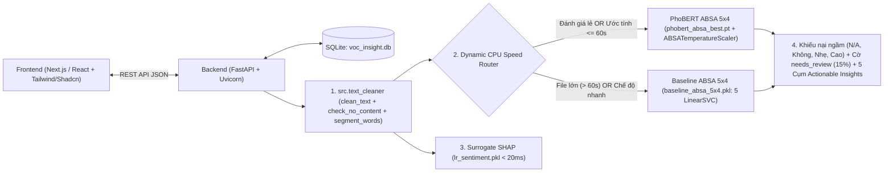

# TÀI LIỆU BÀN GIAO XÂY DỰNG ỨNG DỤNG WEB — VoC-INSIGHT (PHIÊN BẢN v4.1 TRUE ABSA 5×4)

**Tên hệ thống:** Hệ thống Phân tích Tiếng nói Khách hàng & Phát hiện Khiếu nại Ngầm TMĐT (**VoC-Insight v4.1**)  
**Bộ dữ liệu chuẩn:** UIT-ViSFD (Vietnamese Smartphone Feedback Dataset — đánh giá điện thoại tiếng Việt; sau dedup sạch: `7,762` Train / `250` Eyeball / `300` Calib / `560` Val / `2,224` Test; fingerprint train `ad1b0833a88851e2`)  
**Kiến trúc ứng dụng mục tiêu:** **FastAPI (Python Backend, tái sử dụng trực tiếp package `src/`)** + **SQLite (`voc_insight.db`)** + **React / Next.js (Frontend)**  

> **Tóm tắt chuẩn v4.1 (True ABSA 5×4 — bắt buộc đọc trước khi code App):**
> - **Không viết lại code lõi:** Toàn bộ hàm tiền xử lý, model, hiệu chuẩn nhiệt độ, phân loại khiếu nại ngầm và đọc Excel bẩn **đã có sẵn trong package `src/`** ([src/text_cleaner.py](src/text_cleaner.py), [src/labels.py](src/labels.py), [src/modeling.py](src/modeling.py), [src/excel_ingestion.py](src/excel_ingestion.py)). Backend FastAPI chỉ cần `from src... import ...`, tuyệt đối không copy-paste lại regex cũ.
> - **Tải Weights PhoBERT (~540 MB):** File `models/phobert_absa_v4/phobert_absa_best.pt` nằm trong `.gitignore`. Khi clone repo về làm App, tải `phobert_absa_outputs_v4.zip` tại **[Google Drive của nhóm](https://drive.google.com/drive/folders/17Fgfqa2IFnCnh2ZJzNE0HpobJKnF7PVs)** và giải nén vào `models/phobert_absa_v4/`.
> - **Checkpoint chính:** `models/phobert_absa_v4/phobert_absa_best.pt` + `calibration.json` (`temps` 5 đầu, `review_budget = 0.15`, `review_conf_threshold = 0.5094`, `MAX_LEN_ABSA = 128`). Trên Windows CPU RAM hẹp, nạp zero-copy bằng `with torch.device('meta'): ...` + `torch.load(..., map_location='cpu', mmap=True, weights_only=True)` + `load_state_dict(..., assign=True)`.
> - **Fallback nhanh:** `models/baseline_absa_5x4.pkl` (`LinearSVC`, `C=0.5`, dùng chung `models/tfidf_vectorizer.pkl`).
> - **Chỉ số Test (`N=2,224`, trích từ [models/model_metadata.json](models/model_metadata.json)):** PhoBERT `absa_macro_f1 = 0.8410` vs Baseline `0.7556` (chênh `+0.0857`, 95% Paired Bootstrap CI `[+0.0757, +0.0954]`); `mean_4cls_macro_f1 = 0.7924` vs `0.6895`; `polarity_given_detected = 0.8358`; `review_exact_match = 0.5567` (`55.67%` câu đúng đồng thời cả 5 khía cạnh).
> - **Cờ kiểm duyệt `needs_review` (ngân sách 15%):** `min_aspect_conf < 0.5094` hoặc `is_no_content` → gắn cờ `15.69%` tập test (`349/2,224` câu), precision bắt lỗi `74.50%`, error recall `26.37%`. *(Không dùng điều kiện mâu thuẫn sao vì 4–5★ có khía cạnh chê chính là khiếu nại ngầm).*
> - **Cột đầu ra Excel v4.1 (`NB06`):** `Hieu_Nang_Cau_Hinh`, `Man_Hinh_Camera`, `Pin_Sac`, `Gia_Ca_Hau_Mai`, `Thiet_Ke_Tong_Quan`, `Du_Doan_Cam_Xuc` (`Tiêu cực` / `Trung lập` / `Tích cực` / `Hỗn hợp`), `Do_Tu_Tin_Thap_Nhat`, `Khia_Canh_Can_Kiem`, `So_Khia_Canh_Tieu_Cuc`, `Muc_Do_Khieu_Nai_Ngam` (`N/A` / `Không` / `Nhẹ` / `Cao`), `Khieu_Nai_Ngam_4_5_Sao`, `Can_Kiem_Duyet`, `Model_Su_Dung`.

---

## 1. TỔNG QUAN KIẾN TRÚC & CHIẾN LƯỢC HYBRID AI TRÊN PRODUCTION



### 1.1. Chiến lược Hybrid AI (Phân vai thông minh)
1. **Phân tích 1 đánh giá tức thì (`POST /api/v1/predict`):**
   - Dùng **PhoBERT ABSA v4 (`PhoBertABSA` 5 đầu × 4 trạng thái)** kết hợp **`ABSATemperatureScaler`** (`calibration.json`) để dự đoán đồng thời 5 khía cạnh và xác suất hiệu chuẩn.
   - Song song dùng **`lr_sentiment.pkl` + `tfidf_vectorizer.pkl` + `shap.LinearExplainer`** (Surrogate model) để trích xuất trọng số từ khóa giải thích thời gian thực (<20ms).
2. **Phân tích hàng loạt File Excel/CSV (`POST /api/v1/upload/analyze`):**
   - Dùng đúng logic **Dynamic CPU Speed Router** trong [notebooks/06_excel_auto_detector.ipynb](notebooks/06_excel_auto_detector.ipynb): chạy thử tối đa 8 dòng đầu để đo tốc độ CPU thực tế (`ms/row` sau warm-up).
   - **Nếu tổng thời gian ước tính $\le 60$ giây** (hoặc `model_mode == "phobert"`): chạy **`PhoBERT_ABSA_v4`** theo batch (`batch_size=32`).
   - **Nếu ước tính $> 60$ giây** (hoặc không có file `.pt`, hoặc `model_mode == "baseline"`): tự động fallback sang **`Baseline_TFIDF_LinearSVC`** (`baseline_absa_5x4.pkl`), xử lý hàng nghìn dòng trong < 1 giây và ghi rõ tên model vào cột `Model_Su_Dung`.

### 1.2. Chỉ số Benchmark Chính thức (Tập Test Độc lập — 2,224 đánh giá)
Trích xuất trực tiếp từ [models/model_metadata.json](models/model_metadata.json):

| Chỉ số (Test `N=2,224`) | Baseline TF-IDF (`LinearSVC`, `C=0.5`) | **PhoBERT ABSA v4.0 (`MAX_LEN=128`)** | Chênh lệch ($\Delta$) |
| :--- | :---: | :---: | :---: |
| **ABSA Macro F1 (end-to-end)** | `0.7556` | **`0.8410`** | **+0.0857** *(CI 95%: `[+0.0757, +0.0954]`)* |
| **ABSA Micro F1** | `0.7576` | **`0.8405`** | **+0.0829** |
| **Mean 4-class Macro F1 (5 khía cạnh)** | `0.6895` | **`0.7924`** | **+0.1029** |
| **Polarity-given-Detected Macro F1** | `0.7854` | **`0.8358`** | **+0.0504** |
| **Tập xung đột (`has_conflict`, `n=286`)** | `0.6530` | **`0.7500`** | **+0.0970** |
| **Tập xung đột có Negative (`n=141`)** | `0.6316` | **`0.7284`** | **+0.0968** |
| **Review Exact-Match (đúng cả 5 khía cạnh)** | — | **`0.5567` (55.67%)** | *(44.33% câu sai $\ge 1$ khía cạnh)* |

**F1 4 lớp theo từng khía cạnh (PhoBERT vs Baseline):**
- `PERF_FEAT (absa_0)`: **`0.7592`** vs `0.6427` *(Negative F1: `0.8797`)*
- `SCREEN_CAM (absa_1)`: **`0.8335`** vs `0.7309` *(Negative F1: `0.8371`)*
- `BATTERY (absa_2)`: **`0.8088`** vs `0.7251` *(Negative F1: `0.8765`)*
- `PRICE_SER (absa_3)`: **`0.8235`** vs `0.7421` *(Negative F1: `0.7192`)*
- `DESIGN_GEN (absa_4)`: **`0.7370`** vs `0.6068` *(Negative F1: `0.7469`)*

---

## 2. DANH MỤC TÀI NGUYÊN BÀN GIAO & CÀI ĐẶT MÔI TRƯỜNG

### 2.1. Các file cần nạp vào Backend
* **Package `src/` (import trực tiếp, không viết lại):**
  * `src/text_cleaner.py`: `clean_text`, `check_no_content`, `segment_words`, `mask_tabular_pii`.
  * `src/labels.py`: `ABSA_COLS`, `ABSA_STATES`, `ABSA_STATE_VI`, `ASPECT_GROUPS`, `derive_overall_sentiment`, `classify_silent_complaint_levels`, `compute_absa_metrics`, `review_exact_match`.
  * `src/modeling.py`: `PhoBertABSA`, `ABSATemperatureScaler`, `MAX_LEN_ABSA` (`128`).
  * `src/excel_ingestion.py`: `read_any_file`, `pick_best_sheet`, `detect_header_row`, `detect_text_columns`, `detect_star_column`, `build_clean_table`.
* **Thư mục `models/`:**
  * `phobert_absa_v4/phobert_absa_best.pt` (~540 MB — tải từ **[Google Drive](https://drive.google.com/drive/folders/17Fgfqa2IFnCnh2ZJzNE0HpobJKnF7PVs)** và bỏ vào `models/phobert_absa_v4/`).
  * `phobert_absa_v4/config.json`, `vocab.txt`, `bpe.codes`, `tokenizer_config.json`, `added_tokens.json`, `calibration.json`, `training_history.json` (đã có sẵn trong Git, giúp nạp PhoBERT **100% offline**).
  * `tfidf_vectorizer.pkl`, `baseline_absa_5x4.pkl`, `baseline_absa_metrics.json`, `lr_sentiment.pkl` (dùng cho Surrogate SHAP), `model_metadata.json`.
* **Thư mục `data/processed/`:**
  * `train_clean.csv` (`7,762` dòng — dùng làm background matrix cho `shap.LinearExplainer`, có thể sample 200 dòng cố định `random_state=42` lúc khởi động server để tiết kiệm RAM).
  * `test_pred_phobert.csv` (`2,224` dòng — dùng để **seed dữ liệu ban đầu** vào SQLite `voc_insight.db`). *(Lưu ý: tuyệt đối không dùng `dev_pred_phobert.csv` để báo cáo chỉ số vì tập dev đã dùng cho early stopping và calibration).*
  * `actionable_insights.csv` (`5` cụm giải pháp tương ứng 5 khía cạnh ABSA, phủ 100% trên `1,391` câu có ít nhất 1 khía cạnh tiêu cực của tập Test, tổng `2,191` lượt chê khía cạnh).
  * `sample_excel_predicted.xlsx` (`25` dòng kết quả mẫu từ NB06).
* **Thư mục `data/samples_messy/`:** 10 file Excel/CSV/HTML mô phỏng (synthetic) định dạng xuất thô từ sàn TMĐT để gắn nút demo nhanh trên UI Tab 2.
* **Thư mục `reports/figures/`:** `fig_absa_5x4_heatmap.png`, `fig_absa_v4_confusion.png`, `shap_top_negative_words.png`, và các biểu đồ EDA để hiển thị ở Tab 4.

### 2.2. Thư viện Python cho Backend
Ngoài [requirements.txt](requirements.txt), cài thêm cho FastAPI:
```bash
pip install fastapi uvicorn python-multipart sqlalchemy pydantic
```

---

## 3. BẢNG QUY ĐỔI NHÃN CHUẨN & CÁCH GỌI MODULE LÕI `src/`

### 3.1. Bảng ánh xạ Nhãn v4.1 (Label Mapping)

**5 Nhóm Khía cạnh (`ASPECT_GROUPS` / cột `absa_0..absa_4`):**
| ID (`j`) | Mã nhóm | Tên cột Excel (`NB06`) | Tiếng Việt hiển thị | Nhóm UIT-ViSFD gốc |
| :---: | :--- | :--- | :--- | :--- |
| `0` | `PERF_FEAT` | `Hieu_Nang_Cau_Hinh` | **Hiệu năng & Cấu hình** | `PERFORMANCE`, `STORAGE`, `FEATURES` |
| `1` | `SCREEN_CAM` | `Man_Hinh_Camera` | **Màn hình & Camera** | `SCREEN`, `CAMERA` |
| `2` | `BATTERY` | `Pin_Sac` | **Thời lượng Pin & Sạc** | `BATTERY` |
| `3` | `PRICE_SER` | `Gia_Ca_Hau_Mai` | **Giá cả & Hậu mãi** | `PRICE`, `SER&ACC` |
| `4` | `DESIGN_GEN` | `Thiet_Ke_Tong_Quan` | **Thiết kế & Tổng quan** | `DESIGN`, `GENERAL`, `OTHERS` |

**4 Trạng thái Cực tính mỗi Khía cạnh (`ABSA_STATES` / `ABSA_STATE_VI`):**
| Giá trị | Mã trạng thái | Tiếng Việt hiển thị | Màu UI (Hex) |
| :---: | :--- | :--- | :---: |
| `0` | `None` | **Không đề cập** | `#9CA3AF` (Xám) |
| `1` | `Negative` | **Tiêu cực** | `#EF4444` (Đỏ) |
| `2` | `Neutral` | **Trung lập** | `#F59E0B` (Vàng cam) |
| `3` | `Positive` | **Tích cực** | `#10B981` (Xanh lá) |

**Cảm xúc tổng hợp (`Du_Doan_Cam_Xuc`) & Mức độ Khiếu nại Ngầm (`Muc_Do_Khieu_Nai_Ngam`):**
- **`Du_Doan_Cam_Xuc`:** suy ra từ 5 đầu ABSA qua `derive_overall_sentiment(pred_absa)`, nhưng nếu câu vừa có khía cạnh Tiêu cực (`1`) vừa có khía cạnh Tích cực (`3`) thì gán **`Hỗn hợp`** (tránh gán "Tiêu cực" một chiều cho câu kiểu *"Máy mượt nhưng pin yếu"*).
- **`Muc_Do_Khieu_Nai_Ngam` (tính qua `classify_silent_complaint_levels(stars, pred_absa)`):**
  - `N/A`: đánh giá 1–3★ hoặc không có cột số sao.
  - `Không`: 4–5★ và không có khía cạnh nào Tiêu cực (`947` câu trên Test).
  - `Nhẹ`: 4–5★ có đúng 1 khía cạnh Tiêu cực nhưng vẫn có ít nhất 1 khía cạnh Tích cực (`242` câu trên Test).
  - `Cao` (`Khieu_Nai_Ngam_4_5_Sao = True`): 4–5★ có $\ge 2$ khía cạnh Tiêu cực, hoặc có 1 khía cạnh Tiêu cực mà không khen khía cạnh nào (`208` câu trên Test, chiếm `14.89%` nhóm 4–5★).

---

### 3.2. Cách nạp PhoBERT ABSA v4 Zero-Copy & Dự đoán trong Backend (`app/core/ai_engine.py`)

Tuyệt đối không viết class model mới; gọi trực tiếp `src/`:

```python
import os, json, joblib, torch
import numpy as np
import pandas as pd
from transformers import AutoConfig, AutoTokenizer

from src.text_cleaner import clean_text, check_no_content, segment_words, mask_tabular_pii
from src.labels import (
    ABSA_STATE_VI, ASPECT_GROUPS,
    classify_silent_complaint_levels, derive_overall_sentiment,
)
from src.modeling import ABSATemperatureScaler, MAX_LEN_ABSA, PhoBertABSA

ASPECT_COL_VI = [
    'Hieu_Nang_Cau_Hinh', 'Man_Hinh_Camera', 'Pin_Sac',
    'Gia_Ca_Hau_Mai', 'Thiet_Ke_Tong_Quan',
]
SENT_MAP_VI = {0: 'Tiêu cực', 1: 'Trung lập', 2: 'Tích cực'}

def load_phobert_v4_bundle(save_dir: str = 'models/phobert_absa_v4'):
    weights_p = os.path.join(save_dir, 'phobert_absa_best.pt')
    calib_p = os.path.join(save_dir, 'calibration.json')
    if not (os.path.exists(weights_p) and os.path.exists(calib_p)):
        return None
    tok = AutoTokenizer.from_pretrained(save_dir)
    cfg = AutoConfig.from_pretrained(save_dir)
    cfg.vocab_size = len(tok)
    # Zero-copy mmap loading: chạy mượt trên máy Windows 8GB RAM không bị MemoryError
    with torch.device('meta'):
        model = PhoBertABSA(config=cfg, dropout=0.2)
    sd = torch.load(weights_p, map_location='cpu', mmap=True, weights_only=True)
    model.load_state_dict(sd, strict=False, assign=True)
    emb = model.encoder.embeddings
    emb.position_ids = torch.arange(cfg.max_position_embeddings, dtype=torch.long).expand((1, -1))
    emb.token_type_ids = torch.zeros(emb.position_ids.size(), dtype=torch.long)
    model.eval()

    c_info = json.load(open(calib_p, encoding='utf-8'))
    scaler = ABSATemperatureScaler.from_dict(c_info)
    return {
        'model': model,
        'tokenizer': tok,
        'scaler': scaler,
        'review_conf_threshold': float(c_info['review_conf_threshold']),  # 0.5094
    }
```

**Quy tắc tính `needs_review` và `Khia_Canh_Can_Kiem` (đồng bộ 100% với `NB04` & `NB06`):**
```python
# probs có shape (N, 5, 4) sau khi qua scaler.predict_probs(logits)
pred_absa = probs.argmax(axis=-1)              # (N, 5), giá trị 0..3
aspect_conf = np.round(probs.max(axis=-1), 4)  # (N, 5)
min_conf = np.round(aspect_conf.min(axis=-1), 4)
th = bundle['review_conf_threshold']           # 0.5094 (ngân sách 15% trên df_calib)

needs_review = (min_conf < th) | is_no_content
# Chỉ liệt kê khía cạnh có độ tự tin < th và dự đoán khác None (0)
khia_canh_can_kiem = [
    ', '.join(ASPECT_COL_VI[j] for j in range(5) if aspect_conf[i, j] < th and pred_absa[i, j] != 0)
    for i in range(len(pred_absa))
]
```

---

### 3.3. Động cơ 5 Cụm Đề Xuất Hành Động (`data/processed/actionable_insights.csv`)

Ở bản v4.1, 5 cụm hành động khớp **1-1 với 5 đầu khía cạnh ABSA** (`pred_absa_j == 1`, tức `NEG_IDX = 1`), không dùng regex `CAM_PATTERN` cũ. Một đánh giá chê nhiều khía cạnh sẽ đóng góp vào tất cả các cụm tương ứng (trên tập Test: `1,391` câu có ít nhất 1 khía cạnh tiêu cực tạo ra `2,191` lượt chê khía cạnh, độ phủ **100%**):

| `cluster_id` | `aspect_id` | Tên cụm (`aspect_cluster`) | Số câu chê (Test) | `%` trên Test | Từ khóa đặc trưng (`np.log1p(tf) * log_odds`, 0 trùng lặp) |
| :---: | :---: | :--- | :---: | :---: | :--- |
| `1` | `0` | **Hiệu năng & Cấu hình** | `817` | `36.74%` | `tự nhiên, đơ, treo, khởi động, cột, sai lầm` |
| `2` | `4` | **Thiết kế & Tổng quan** | `425` | `19.11%` | `nhựa, cùi, quá tệ, thua, hối hận, khuyên` |
| `3` | `2` | **Thời lượng Pin & Sạc** | `385` | `17.31%` | `tuột, sac, tụt, hao, đồng hồ, mau` |
| `4` | `1` | **Màn hình & Camera** | `300` | `13.49%` | `xấu, mờ, vàng, ám, nhợt nhạt, tối` |
| `5` | `3` | **Giá cả & Hậu mãi** | `264` | `11.87%` | `bảo hành, niềm, phí, lung tung, đắt, càng` |

---

## 4. THIẾT KẾ CƠ SỞ DỮ LIỆU SQLITE (`voc_insight.db`)

Khi Backend FastAPI khởi động lần đầu (`lifespan` event), nếu bảng `reviews` trống thì tự động **seed `2,224` dòng từ `data/processed/test_pred_phobert.csv`**.

```sql
CREATE TABLE IF NOT EXISTS upload_batches (
    id INTEGER PRIMARY KEY AUTOINCREMENT,
    file_name TEXT NOT NULL,
    detected_format TEXT,
    sheet_name TEXT,
    total_rows INTEGER NOT NULL,
    model_used TEXT NOT NULL,           -- 'PhoBERT_ABSA_v4' hoặc 'Baseline_TFIDF_LinearSVC'
    created_at TIMESTAMP DEFAULT CURRENT_TIMESTAMP
);

CREATE TABLE IF NOT EXISTS reviews (
    id INTEGER PRIMARY KEY AUTOINCREMENT,
    source TEXT NOT NULL,               -- 'seed_test' | 'buyer_portal' | 'excel_upload'
    batch_id INTEGER REFERENCES upload_batches(id),
    n_star INTEGER,                     -- 1..5 (hoặc NULL nếu file Excel không có cột sao)
    sentence_clean TEXT NOT NULL,       -- Văn bản đã che PII [PHONE], [ORDER_ID], [EMAIL], [URL]
    sentence_seg TEXT NOT NULL,         -- Văn bản đã tách từ pyvi
    is_no_content BOOLEAN DEFAULT 0,
    pred_absa_0 INTEGER NOT NULL,       -- 0..3 (PERF_FEAT)
    pred_absa_1 INTEGER NOT NULL,       -- 0..3 (SCREEN_CAM)
    pred_absa_2 INTEGER NOT NULL,       -- 0..3 (BATTERY)
    pred_absa_3 INTEGER NOT NULL,       -- 0..3 (PRICE_SER)
    pred_absa_4 INTEGER NOT NULL,       -- 0..3 (DESIGN_GEN)
    absa_conf_0 REAL,
    absa_conf_1 REAL,
    absa_conf_2 REAL,
    absa_conf_3 REAL,
    absa_conf_4 REAL,
    min_aspect_conf REAL,
    overall_sentiment TEXT NOT NULL,    -- 'Tiêu cực' | 'Trung lập' | 'Tích cực' | 'Hỗn hợp'
    neg_aspect_count INTEGER NOT NULL,  -- 0..5 (So_Khia_Canh_Tieu_Cuc)
    silent_complaint_level TEXT NOT NULL, -- 'N/A' | 'Không' | 'Nhẹ' | 'Cao'
    is_silent_complaint_45 BOOLEAN DEFAULT 0, -- Muc_Do == 'Cao'
    aspects_to_review TEXT DEFAULT '',  -- Khia_Canh_Can_Kiem
    needs_review BOOLEAN DEFAULT 0,
    review_status TEXT DEFAULT 'pending', -- 'pending' | 'resolved' | 'ignored'
    model_used TEXT DEFAULT 'PhoBERT_ABSA_v4',
    created_at TIMESTAMP DEFAULT CURRENT_TIMESTAMP
);
```

---

## 5. ĐẶC TẢ REST API CONTRACT (FASTAPI `/api/v1`)

### 5.1. `POST /api/v1/predict` — Phân tích tức thì 1 câu & Lưu đồng bộ sang Dashboard
* **Pipeline xử lý:** `clean_text` $\rightarrow$ `check_no_content` $\rightarrow$ `segment_words` $\rightarrow$ `PhoBertABSA` + `ABSATemperatureScaler` $\rightarrow$ `classify_silent_complaint_levels` $\rightarrow$ `SHAP LinearExplainer` (Surrogate LR) $\rightarrow$ `INSERT` vào SQLite (`source='buyer_portal'`).
* **Response JSON mẫu (`200 OK`):**
  ```json
  {
    "success": true,
    "data": {
      "review_id": 2225,
      "sentence_clean": "đặt đơn [ORDER_ID] máy mượt chụp đẹp nhưng pin tụt quá, gọi [PHONE] không ai nghe",
      "is_no_content": false,
      "model_used": "PhoBERT_ABSA_v4",
      "star_rating": 5,
      "overall_sentiment": "Hỗn hợp",
      "aspects": [
        { "id": 0, "code": "PERF_FEAT", "name": "Hiệu năng & Cấu hình", "state_id": 3, "state": "Tích cực", "confidence": 0.912 },
        { "id": 1, "code": "SCREEN_CAM", "name": "Màn hình & Camera", "state_id": 3, "state": "Tích cực", "confidence": 0.884 },
        { "id": 2, "code": "BATTERY", "name": "Thời lượng Pin & Sạc", "state_id": 1, "state": "Tiêu cực", "confidence": 0.935 },
        { "id": 3, "code": "PRICE_SER", "name": "Giá cả & Hậu mãi", "state_id": 1, "state": "Tiêu cực", "confidence": 0.812 },
        { "id": 4, "code": "DESIGN_GEN", "name": "Thiết kế & Tổng quan", "state_id": 0, "state": "Không đề cập", "confidence": 0.781 }
      ],
      "min_aspect_conf": 0.781,
      "neg_aspect_count": 2,
      "silent_complaint_level": "Cao",
      "is_silent_complaint_45": true,
      "needs_review": false,
      "aspects_to_review": "",
      "shap_surrogate_explanation": {
        "note": "SHAP trên Surrogate LR/TF-IDF (giải thích gián tiếp)",
        "tokens": [
          { "token": "tụt", "shap_value": 0.421, "impact": "negative", "color": "red" },
          { "token": "mượt", "shap_value": -0.245, "impact": "positive", "color": "green" }
        ]
      }
    }
  }
  ```

### 5.2. `POST /api/v1/upload/inspect` & `POST /api/v1/upload/analyze` (Tab 2)
* Gọi trực tiếp `read_any_file`, `pick_best_sheet`, `detect_header_row`, `build_clean_table` từ [src/excel_ingestion.py](src/excel_ingestion.py) và `mask_tabular_pii` từ [src/text_cleaner.py](src/text_cleaner.py).
* Khi xuất file Excel tải về, giữ đầy đủ bộ cột chuẩn của `NB06` (`Hieu_Nang_Cau_Hinh..Thiet_Ke_Tong_Quan`, `Du_Doan_Cam_Xuc`, `Do_Tu_Tin_Thap_Nhat`, `Khia_Canh_Can_Kiem`, `So_Khia_Canh_Tieu_Cuc`, `Muc_Do_Khieu_Nai_Ngam`, `Khieu_Nai_Ngam_4_5_Sao`, `Can_Kiem_Duyet`, `Model_Su_Dung`).

### 5.3. `GET /api/v1/dashboard/overview` (Tab 1 & Tab 4)
* **Số liệu mặc định ban đầu từ `test_pred_phobert.csv` (`2,224` câu):**
  * `needs_review_count`: **`349`** (`15.69%`, ngân sách 15% với `review_conf_threshold = 0.5094`).
  * `silent_complaint_dist`: `Không: 947`, `Nhẹ: 242`, `Cao: 208` (`14.89%` trong nhóm 4–5★), `N/A: 827`.
  * `actionable_insights`: 5 cụm từ `data/processed/actionable_insights.csv` (hoặc đếm động số câu có `pred_absa_j == 1` trong DB).
  * `model_metadata`: đọc trực tiếp từ `models/model_metadata.json` và `models/phobert_absa_v4/training_history.json`.

---

## 6. CHECKLIST NGHIỆM THU KHI XÂY APP XONG

- [ ] Backend import trực tiếp từ `src/` (`src.text_cleaner`, `src.labels`, `src.modeling`, `src.excel_ingestion`), không viết lại hàm làm sạch hay bộ đọc Excel.
- [ ] Tải `phobert_absa_outputs_v4.zip` từ [Google Drive](https://drive.google.com/drive/folders/17Fgfqa2IFnCnh2ZJzNE0HpobJKnF7PVs), giải nén vào `models/phobert_absa_v4/` và nạp bằng zero-copy `meta + mmap=True + assign=True` (hoặc tự động fallback sang `Baseline_TFIDF_LinearSVC` nếu chưa tải file `.pt`).
- [ ] Gửi đánh giá chứa SĐT `0901234567` và mã đơn `#ĐH889911` qua `POST /api/v1/predict` $\rightarrow$ DB và UI chỉ lưu `[PHONE]` và `[ORDER_ID]`.
- [ ] Câu đánh giá 5★ vừa khen vừa chê (ví dụ *"Máy mượt nhưng pin tụt nhanh"*) hiển thị `Du_Doan_Cam_Xuc = "Hỗn hợp"`, `Muc_Do_Khieu_Nai_Ngam = "Nhẹ"`, và không bị gán nhầm vào `needs_review` nếu độ tự tin các đầu đều $\ge 0.5094$.
- [ ] Upload đủ cả **10/10 file** trong `data/samples_messy/` $\rightarrow$ 100% đọc thành công và xuất file Excel có đủ cột `Khia_Canh_Can_Kiem`, `Muc_Do_Khieu_Nai_Ngam`, `Model_Su_Dung`.
- [ ] Tab 4 hiển thị đúng bảng đối chiếu v4.0: PhoBERT `absa_macro_f1 = 0.8410` vs Baseline `0.7556` (CI 95% `[+0.0757, +0.0954]`), `mean_4cls_macro_f1 = 0.7924` vs `0.6895`, `review_exact_match = 0.5567`, kèm hình `fig_absa_v4_confusion.png` và ghi chú SHAP là Surrogate LR/TF-IDF.
