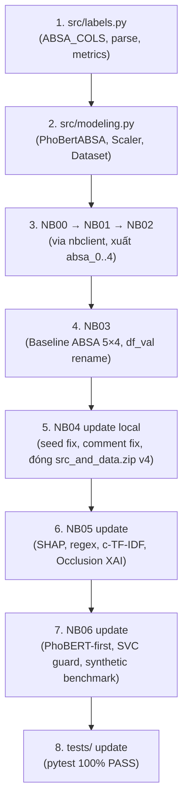

# Kế Hoạch Triển Khai VoC-Insight v4.0: True ABSA (5 × 4) & Khắc Phục Toàn Bộ problem.md

> [!IMPORTANT]
> Hạn nộp: **< 3 ngày** | Chặng 1 local (~15 phút) + Chặng 2 Colab GPU (~10 phút do bạn chạy)

---

## Bối cảnh & Mục tiêu

Nâng cấp từ v3 (1 sentiment chung + 5 binary aspect 0/1) lên **True ABSA 5 khía cạnh × 4 trạng thái**:

| Thành phần | v3 (hiện tại) | v4.0 (mục tiêu) |
|---|---|---|
| Nhãn aspect | `asp_0..4` ∈ {0,1} binary | `absa_0..4` ∈ {0=None, 1=Neg, 2=Neu, 3=Pos} |
| Đầu ra model | `Linear(768,1)` × 5 (BCE) | `Linear(768,20)` → reshape `(B,5,4)` (5× CE) |
| Sentiment | Phân loại riêng (Neg/Neu/Pos) | Suy diễn từ ABSA matrix |
| Baseline metric | Multi-label F1 `0.9058` | 4-class Macro F1 (Mean across 5 aspects) |

---

## Bảng Khắc Phục 13 Điểm problem.md

| # | Vấn đề | Cách sửa | File chịu ảnh hưởng |
|---|---|---|---|
| 1 | Chưa phải ABSA thật; câu trái chiều → Neutral F1 ~0.50 | Đổi sang đầu ra 5×4 (`absa_0..4` ∈ {0,1,2,3}) học trực tiếp từ `{ASPECT#Polarity}` | `src/labels.py`, `src/modeling.py`, NB00–NB04 |
| 2 | Aspect F1 ~0.906 bị tần suất DESIGN_GEN (~80%) kéo lên | Bỏ `{OTHERS}` khỏi DESIGN_GEN; chấm bằng ABSA E2E Micro/Macro F1 + 4-class Macro F1 + bảng đối chiếu Majority/All-1 Baseline | `src/labels.py`, NB03, NB04 |
| 3 | Primary aspect F1 ~0.50 nhưng NB05 chia cụm theo nó | NB05 gom cụm theo multi-label `pred_absa_j == 1` (Negative) — phủ 100% khía cạnh bị chê | NB05 |
| 4 | Regex Camera/Màn hình NB05 bắt nhầm (12/113 câu màn hình) | Tách `CAM_PAT` chặt và `SCR_PAT` riêng (xem chi tiết ở mục NB05 bên dưới) | NB05 |
| 5 | `matched_keywords` gõ cứng; SHAP LR ≠ PhoBERT insights | Rút `extracted_keywords` tự động bằng c-TF-IDF từng cụm; thêm PhoBERT Occlusion XAI; ghi rõ "Surrogate SHAP" | NB05 |
| 6 | NB04 không lưu output cell nào (0/33 output) | Chạy lại trên Colab GPU; tải cả `.ipynb` (đủ output) lẫn `.zip` về repo | NB04 |
| 7 | "Blackbox" dùng để chọn model/early-stopping = thực chất là Validation | Đổi tên `df_val` (Validation, 560 dòng); chỉ gọi `df_test` (2,224 dòng) là unbiased test set | `src/modeling.py`, NB03, NB04 |
| 8 | NB06 crash nếu LinearSVC thắng & chưa dùng PhoBERT inference | PhoBERT-first inference (~2s CPU), fallback Baseline ABSA an toàn với `hasattr` guard + `expit(decision_function)` | NB06 |
| 9 | "10/10 PASS" trên 10 file tự tạo cứng `len==25` | Gọi rõ Synthetic Regression Benchmark + thêm `analyze_excel_file()` không hardcode | NB06 |
| 10 | SHAP lấy `X_te[:400]` & `count>=3` gây nhiễu (mau, hối_hận) | Chạy SHAP toàn bộ 2,224 câu Test, ngưỡng `count>=10`, tính per-aspect tiêu cực | NB05 |
| 11 | NB03 xếp "kém"/"hơi" vào phủ định & thiếu base rate đúng | Tách `kém|hơi` khỏi nhóm phủ định; thêm bảng Error Rate vs Correct Base Rate + Lift trên `df_eyeball` | NB03 |
| 12 | NB04: `torch.manual_seed(42)` sau khi tạo model; comment "562" cũ | `seed_everything(42)` **TRƯỚC** khi tạo `PhoBertABSA`; sửa comment `562 → 560` | NB04 |
| 13 | pyvi ghép sai `Mà_e` ở NB06 | Tham chiếu kết quả E04 (pyvi vs VnCoreNLP: +0.0011 F1, giữ pyvi tránh Java dependency) | NB06, README.md |

---

## Thay Đổi Chi Tiết Từng Thành Phần

### `src/labels.py` (MODIFY)

**Thêm hằng số:**
```python
ABSA_STATES    = ['None', 'Negative', 'Neutral', 'Positive']
ABSA_STATE_VI  = ['Không có', 'Tiêu cực', 'Trung lập', 'Tích cực']
ABSA_COLS      = [f'absa_{i}' for i in range(5)]  # absa_0..absa_4
_ABSA_POL_MAP  = {'Negative': 1, 'Neutral': 2, 'Positive': 3}
```

**Cập nhật `parse_visfd_labels()`:**
- Trả thêm khóa `'absa': [s0, s1, s2, s3, s4]` (∈ {0,1,2,3}) thuần từ `{ASPECT#Polarity}`
- `{OTHERS}` → `absa = [0,0,0,0,0]` (KHÔNG gán vào DESIGN_GEN)
- Giữ nguyên `sentiment`, `aspect_group`, `aspects`, `all_aspects` → không làm gãy E01–E10

**Thêm hàm:**
```python
def derive_overall_sentiment(absa_mat: np.ndarray) -> np.ndarray:
    """Suy diễn sentiment tổng thể từ ma trận ABSA (B,5): Neg>Neu>Pos>None."""
    ...

def compute_absa_metrics(y_true_5x4, y_pred_5x4) -> dict:
    """
    Returns:
      absa_micro_f1, absa_macro_f1          — End-to-End ABSA F1 (polarity ∈ {1,2,3})
      mean_4cls_macro_f1, per_aspect_4cls_f1 — 4-class Macro F1 mỗi aspect
      majority_4cls_macro_f1                 — Majority baseline
      all1_presence_macro_f1                 — All-1 presence baseline
      polarity_given_detected_macro_f1       — F1 polarity khi aspect đúng là có mặt
    """
    ...
```

---

### `src/modeling.py` (MODIFY)

**Thêm `PhoBertABSA(nn.Module)`:**
```python
class PhoBertABSA(nn.Module):
    def __init__(self, phobert, num_aspects=5, num_states=4, dropout=0.1):
        super().__init__()
        self.phobert = phobert
        self.dropout = nn.Dropout(dropout)
        self.head    = nn.Linear(768, num_aspects * num_states)  # 20

    def forward(self, input_ids, attention_mask):
        cls = self.phobert(input_ids, attention_mask).last_hidden_state[:, 0]
        logits = self.head(self.dropout(cls))
        return logits.view(-1, 5, 4)   # (B, 5, 4)
```

**Thêm `ABSATemperatureScaler`:** 5 nhiệt độ T_0..T_4 độc lập, fit trên `df_calib` (300 rows).

**Thêm `compute_absa_class_weights(y_train_5x4, power=0.5)`:** tính `w_j` cho từng aspect.

**Cập nhật `ViSFDDataset` & `dynamic_collate_fn`:** hỗ trợ `absa_targets (B,5)` kiểu `torch.long`; `MAX_LEN=128` default.

> [!NOTE]
> Giữ `PhoBertMultiTask` cũ cho tương thích E04/E05 — không xóa.

---

### NB00 (MODIFY)
- Xuất `absa_0..absa_4` vào `train_raw.csv`, `dev_raw.csv`, `test_raw.csv`, `visfd_merged_raw.csv`
- Thêm bảng kiểm tra phân bố 4 trạng thái (None/Neg/Neu/Pos) cho từng khía cạnh

### NB01 (MODIFY)
- Giữ nguyên `absa_0..4` qua bước làm sạch & dedup
- Dedup nội bộ dev kiểm tra mâu thuẫn trên `absa_0..4`

### NB02 (MODIFY)
- Thêm Heatmap phân bố 4 trạng thái thật của từng khía cạnh → `eda_aspect_sentiment_heatmap.png`

### NB03 (MODIFY)
- Đổi `df_blackbox` → **`df_val`** (Validation Dev, 560 dòng) trong toàn bộ docstring/comment
- Huấn luyện Baseline ABSA 5×4: `Pipeline` + `StratifiedKFold(5)` thuần trên `df_train` cho từng khía cạnh 4 lớp
  - Thử: `ComplementNB`, `LogisticRegression` (C∈[0.5,1,2,5], class_weight∈[None,'balanced',smooth_w_j]), `LinearSVC` (C∈[0.1,0.3,0.5,1,2])
- Lưu `models/baseline_absa_pipelines.pkl` và `models/baseline_absa_lr.pkl` (5 LR dùng shared `tfidf_vectorizer.pkl`)
- In bảng đối chiếu Majority/All-1 Baseline
- Sửa `classify_err`: tách `kém|hơi` khỏi nhóm phủ định; thêm Base Rate/Lift
- Xuất `test_pred_baseline.csv` với `pred_absa_0..4`

### NB04 — Chạy trên Colab GPU (MODIFY)

> [!CAUTION]
> **Chạy trên Colab T4** — KHÔNG chạy local (OOM). Bạn upload và Run All.

- `seed_everything(42)` **TRƯỚC** khi tạo `PhoBertABSA` (sửa bug hiện tại)
- Hyperparams (từ winner E05): `MAX_LEN=128`, `LR=3e-5`, `EPOCHS=6`, `PATIENCE=2`, `fp16=True` (AMP)
- Loss: trung bình 5× `CrossEntropyLoss(weight=w_j, label_smoothing=0.05)`
- Fit `ABSATemperatureScaler` trên `df_calib`; đánh giá 1 lần trên `df_test`
- Sửa comment: `Blackbox (562)` → `Validation (560)`
- Xuất `phobert_absa_outputs_v4.zip` (bao gồm `test_pred_phobert.csv` với `pred_absa_0..4`)

### NB05 (MODIFY)

**Regex chặt (thay thế regex cũ):**
```python
CAM_PAT = r'(?<!\w)(?:camera|chụp(?:\s+ảnh|\s+hình)?|selfie|zoom|ống\s+kính|cam\s+(?:trước|sau|góc|chính|phụ|mờ|nét|đẹp|tệ|kém|lỗi|xấu)|quay\s+(?:video|phim|clip))(?!\w)'

SCR_PAT = r'(?<!\w)(?:màn\s*hình|màng\s*hình|cảm\s*ứng|hiển\s*thị|tấm\s*nền|ám\s+(?:vàng|xanh|hồng|màn)|sọc\s+màn|độ\s+sáng|bóng\s+mờ|loạn\s+cảm\s+ứng)(?!\w)'
```

**SHAP:** toàn bộ 2,224 câu Test; `count >= 10`; tổng thể + riêng từng khía cạnh

**Thêm:** PhoBERT Leave-One-Word-Out Occlusion XAI trên 3 câu mẫu đa khía cạnh

**Cụm Actionable Insights:** gom theo `pred_absa_j == 1` (multi-label Negative) thay vì primary aspect

**Output:** `shap_top_negative_words.png` + `shap_per_aspect_negative.png` (mới)

**c-TF-IDF:** Rút `extracted_keywords` tự động từng cụm; đổi tên cột `action_playbook`

### NB06 (MODIFY)
- PhoBERT ABSA 5×4 inference đầu tiên (~2s CPU / 25 dòng)
- Fallback Baseline ABSA an toàn:
  ```python
  if hasattr(pipe, 'predict_proba'):
      proba = pipe.predict_proba(X)
  else:
      proba = expit(pipe.decision_function(X))  # LinearSVC
  ```
- Xuất 5 cột trạng thái khía cạnh tên tiếng Việt + `Khia_Canh_Bi_Che` + `Khieu_Nai_Ngam_4_5_Sao`
- Ghi chú tham chiếu E04 (pyvi vs VnCoreNLP: Δ+0.0011 F1, giữ pyvi tránh Java dependency) ngay dưới bước tách từ
- Ghi rõ 10 file synthetic là **Synthetic Regression Benchmark**; thêm `analyze_excel_file()` không hardcode `len==25`

### `tests/` (MODIFY)

| File | Thay đổi |
|---|---|
| `test_src_core.py` | Xác nhận `parse_visfd_labels` với `"Màn hình đẹp nhưng pin tệ"` → `absa == [0,3,1,0,0]`; `"{OTHERS};"` → `[0,0,0,0,0]` |
| `test_task1.py` | Kiểm tra `absa_0..4` có trong CSV, `{OTHERS}` không tăng DESIGN_GEN count |
| `test_task2.py` | Baseline vượt Majority 4-class (mean 4cls Macro F1 > 0.60); khớp `model_metadata.json` |
| `test_task3.py` | PhoBERT vượt Majority 4-class (mean 4cls Macro F1 > 0.70); `absa_micro_f1 > 0.60` |
| `test_task4.py` | CAM_PAT không match nhầm màn hình; SHAP chạy trên 2224 dòng; `extracted_keywords` từ c-TF-IDF |
| `test_task6_excel_ingestion.py` | NB06 không crash với SVC fallback; `Khieu_Nai_Ngam_4_5_Sao` có mặt |

---

## Thứ Tự Thực Hiện

### Chặng 1 — Local (~15 phút, agent chạy tự động)



### Chặng 2 — Colab GPU (~10 phút, bạn chạy)

1. Tải lên Colab: `04_phobert_multitask.ipynb` + `src_and_data.zip` v4
2. **Runtime → Run All** (~8–10 phút trên T4)
3. Tải về:
   - `phobert_absa_outputs_v4.zip` (predictions + model weights)
   - `04_phobert_multitask.ipynb` **(bản có đủ output cells)**
4. Đặt về `D:\E-commerce\` → nhắn agent để tiếp tục

### Hoàn thiện cuối (agent chạy sau Colab)

1. Giải nén `phobert_absa_outputs_v4.zip`
2. Chạy lại NB05 & NB06 trên PhoBERT v4 predictions
3. Cập nhật `TAI_LIEU_BAN_GIAO_APP.md`, `README.md` (số liệu v4)
4. `python -m pytest tests/ -v` → 100% PASS
5. Git commit + push origin main

---

## Kiểm Chứng (Verification)

```powershell
$env:TEMP = $env:TMP = "D:\E-commerce\.tmp_run"
python -m pytest tests/ -v
```

**Tiêu chí pass:**
- `pytest`: 100% tests PASS (0 failed)
- `NB04` trên GitHub có đủ output cells (bảng metrics, đồ thị loss/F1)
- `sample_excel_predicted.xlsx`: 5 cột trạng thái khía cạnh, PII sạch
- `model_metadata.json`: metric v4 khớp `test_pred_phobert.csv`
- SHAP: `shap_per_aspect_negative.png` tồn tại với 5 subplot
- CAM_PAT: 0 false-positive với test cases màn hình

---

## Ràng Buộc Kỹ Thuật

> [!WARNING]
> Không stage các file sau lên git: `*.pt`, `phobert_ecommerce_outputs*.zip`, `src_and_data.zip`, `.tmp_run/`

- **PowerShell prefix bắt buộc:** `$env:TEMP = $env:TMP = "D:\E-commerce\.tmp_run";`
- **Scratch files:** dùng `D:\E-commerce\.tmp_run\` — không dùng `C:\`
- **Backward compat:** Giữ `sentiment`, `aspect_group`, `asp_0..4`, `all_aspects` trong CSV — thêm `absa_0..4` song song
- **Pyvi vs VnCoreNLP:** Giữ pyvi (Δ+0.0011 F1 không đáng, tránh Java dependency)
